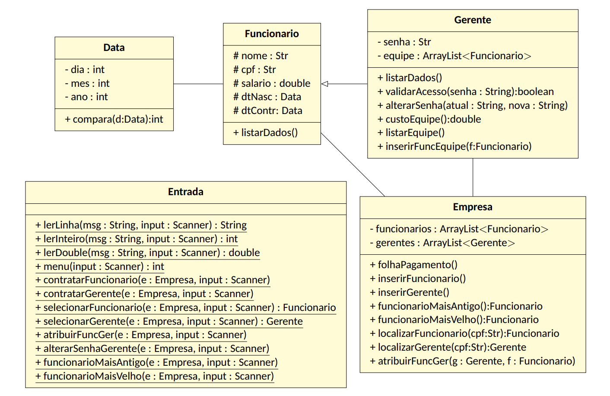

Exercícios da matéria de POO, em Java, sobre uma empresa de RH. Diagrama de classes do exercício:

Algumas coisas do diagrama foram alteradas, como o tipo do valor retornado em um método, e nomes de atributos e métodos, visando o melhor funcionamento do sistema.